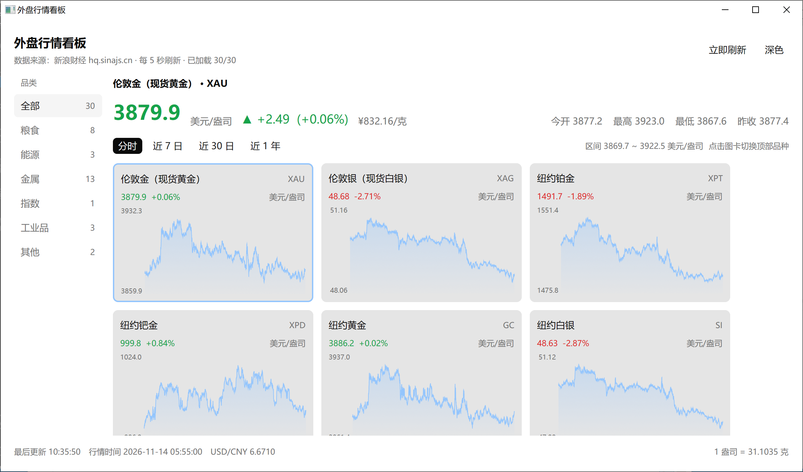

# 外盘行情看板（hq）



一个基于 **Rust + GPUI** 的 Windows 桌面行情看板，用于查看黄金、白银、原油、有色金属、农产品、指数等 **30 个外盘品种**的实时报价与 K 线走势。数据来自新浪财经的公开行情接口，无需 API Key。

## 核心功能

- **实时报价**：30 个品种 + USD/CNY 汇率合并为一次批量请求，每 5 秒刷新一轮。
- **走势图**：每个品种一张迷你图卡，支持「分时 / 近 7 日 / 近 30 日 / 近 1 年」四种时间范围；分时画面积图，日线画蜡烛图。
- **品类导航**：左侧按「全部 / 粮食 / 能源 / 金属 / 指数 / 工业品 / 其他」分组过滤，行尾显示品种数量。
- **顶部大字报价**：显示选中品种的最新价、涨跌额、涨跌幅、今开 / 最高 / 最低 / 昨收；点击任意图卡即可切换。
- **人民币折算**：以美元/金衡盎司计价的 6 个贵金属品种额外显示 `¥/克` 价格。
- **离线兜底**：启动时先用本地缓存绘制上一份行情；网络失败时回退到缓存，并在状态栏明确提示「含本地缓存」。
- **双份存档**：成功取到的行情同时写入 FlowDB（时序）与 SQLite（可用 SQL 查询）。
- **深浅色主题**：右上角一键切换。

## 技术栈

| 分类 | 依赖 | 说明 |
| --- | --- | --- |
| 语言 | Rust（edition 2021） | 单 crate 二进制程序 `hq` |
| UI 框架 | `gpui-kit` 0.8.1 | 基于 Zed 的 GPUI 封装，提供组件库与图表（AreaChart / CandlestickChart） |
| HTTP | `ureq` 3.5 | 阻塞式 HTTP 客户端，仅在后台线程使用 |
| 序列化 | `serde` 1 / `serde_json` 1 | JSONP 载荷与存档 JSON 解析 |
| 时间 | `chrono` 0.4 | 时间戳解析、格式化 |
| 编码 | `encoding_rs` 0.8 | 新浪接口的 GBK/GB18030 解码 |
| 时序库 | `flowdb` 0.8 | 嵌入式 LSM 时序引擎，按品种前缀 + 时间范围扫描 |
| 关系库 | `rusqlite` 0.41（`bundled`） | 随程序编译 SQLite，无需系统安装 |

## 目录结构

```text
hq/
├── Cargo.toml            # 依赖与 release 构建配置
├── Cargo.lock
├── LICENSE               # MIT
├── preview.png           # 界面预览图
├── README.md
└── src/
    ├── main.rs           # 入口：创建 GPUI 应用、初始化主题、打开主窗口
    ├── feed.rs           # 数据源：接口 URL、品种表、GBK 解码、JSONP 解析、缓存回退
    ├── cache.rs          # 原始响应文本的磁盘缓存（按 key 一文一文件）
    ├── archive.rs        # 行情存档：FlowDB + SQLite 双写、建表、迁移、日 K 回填
    ├── model.rs          # 应用状态（GPUI entity）与后台轮询循环
    ├── view.rs           # 主界面布局：标题栏 / 导航 / 报价 / 工具栏 / 图卡网格 / 状态栏
    └── components/       # 可复用的纯展示组件
        ├── mod.rs        # 组件导出
        ├── card.rs       # InstrumentCard：品种图卡
        ├── chart.rs      # MiniChart：分时面积图 / 日 K 蜡烛图；价格格式化
        ├── quote.rs      # QuoteSummary：顶部大字报价
        ├── nav.rs        # NavList：左侧分组导航
        └── segmented.rs  # SegmentedControl：时间范围分段按钮
```

## 运行环境

- **Windows 10/11**：代码用 `%LOCALAPPDATA%` 定位缓存与存档目录，窗口使用 GPUI 原生标题栏；其他平台未做验证。
- **Rust 稳定版工具链**（edition 2021），MSVC 目标。
- 能访问 `hq.sinajs.cn` 与 `stock2.finance.sina.com.cn`（需直连，或通过 `ALL_PROXY` / `HTTPS_PROXY` / `HTTP_PROXY` 环境变量指定代理）。

## 安装与本地运行

```powershell
# 1. 获取代码
git clone <repo-url> hq
cd hq

# 2. 调试运行（首次编译 GPUI 依赖较多，耗时会明显长于普通项目）
cargo run

# 3. 发布构建并运行
cargo run --release

# 4. 运行单元测试
cargo test
```

无需任何环境变量或配置文件，启动即开始取数。

## 数据来源与刷新机制

### 接口

| 用途 | 接口 | 说明 |
| --- | --- | --- |
| 实时报价 | `https://hq.sinajs.cn/rn=1&list=hf_XAU,hf_XAG,...,fx_susdcny` | 一次取回 30 个品种 + 在岸人民币汇率；GBK 编码；**必须带 `Referer`**，否则返回 403 |
| 分时曲线 | `stock2.finance.sina.com.cn/futures/api/jsonp.php/.../GlobalFuturesService.getGlobalFuturesMinLine?symbol=<代码>` | JSONP，字段 `minLine_1d` |
| 日 K 线 | 同上 `getGlobalFuturesDailyKLine?symbol=<代码>` | JSONP，返回全量历史，界面按范围裁剪 |

- HTTP 客户端全局超时 15 秒，响应体上限 8 MB。
- 响应先按 UTF-8 解码，失败再按 GB18030 解码。
- 休市时新浪返回价格为 0，解析阶段会被丢弃，界面显示「暂无数据（可能处于休市时段）」而不是 0。
- 部分品种（纽约黄金、原油等）昨收字段为空，会退回到「昨结算」计算涨跌。

### 刷新节奏

主循环在 `model.rs` 中：

1. 每轮先生成本轮任务：**报价每轮必取**；序列只取「缺失 / 范围不匹配 / 超过 TTL」的品种。
2. 阻塞请求全部放到 `background_executor`，主线程只接收结果并 `cx.notify()` 重绘，UI 不会被网络卡住。
3. 序列按品种均分给最多 **6 个线程**并发拉取。
4. 完成后等待 **5 秒**进入下一轮。

| 数据 | TTL | 说明 |
| --- | --- | --- |
| 实时报价 | 5 秒（每轮） | 新浪现货报价约 1 秒更新一次，5 秒足够 |
| 分时曲线 | 60 秒 | 不需要跟着秒价刷新 |
| 日 K | 600 秒 | 一天只变一次，但要照顾盘中最新一根 |

切换时间范围时会先清空序列并从本地缓存重建，随后由后台循环补齐。

### 本地缓存（`cache.rs`）

- 位置：`%LOCALAPPDATA%\hq\cache`（环境变量缺失时退到临时目录 `hq-cache`）。
- 每个 key 一个 `.txt` 文件：`quotes-all.txt`、`intraday-<代码>.txt`、`daily-<代码>.txt`。
- 只缓存**解析成功**的响应，错误页不会覆盖好数据；写入使用临时文件 + 重命名。
- 断网回退的最大缓存年龄：报价 30 分钟、分时 6 小时、日 K 7 天。
- 缓存条目可能被标记为“已回退”（`Fetched.cached = true`），此时界面状态栏提示「含本地缓存，正在重试网络」，且不计入“最后更新”时间。

### 行情存档（`archive.rs`）

每次**成功从网络**取到数据（缓存回退的不会重复写）都会落两份盘：

- **FlowDB**：`%LOCALAPPDATA%\hq\archive\flowdb`，按 `quote:<品种>` / `intraday:<品种>` / `daily:<品种>` 分组，`ts` 为微秒。
- **SQLite**：`%LOCALAPPDATA%\hq\archive\hq.sqlite3`，表结构：

| 表 | 主键 | 时间口径 |
| --- | --- | --- |
| `quotes` | `(symbol, ts)` | epoch 秒；另有 `fetched_at` 记录本机取数时间 |
| `intraday` | `(symbol, ts)` | epoch 秒 |
| `daily` | `(symbol, date)` | `YYYY-MM-DD` 交易日字符串 |
| `rates` | `(pair, ts)` | epoch 秒，目前只有 `USDCNY` |

- SQLite 启用 WAL、`synchronous = NORMAL`、`busy_timeout = 5s`。
- 接口时间不带时区，两边都按 **UTC** 解释，仅用于排序与去重，不做跨时区换算。
- 启动时会把缓存中已有的日 K 全量历史补进存档（`backfill_daily`），已补过的品种按最后一根蜡烛判断，不重复写入。
- `user_version = 1` 的迁移负责把早期版本的微秒时间戳换算成秒、并把 `daily` 表从 `(symbol, ts)` 改为 `(symbol, date)`。

## 配置说明

项目**没有配置文件、没有 `.env`、也不需要 API Key**。程序自身只读取 `LOCALAPPDATA`（决定缓存与存档位置）；HTTP 客户端还会读取 `ALL_PROXY` / `HTTPS_PROXY` / `HTTP_PROXY` 作为可选代理。所有可调参数都是源码常量，修改后需重新编译：

| 常量 | 位置 | 值 | 含义 |
| --- | --- | --- | --- |
| `QUOTE_INTERVAL` | `model.rs` | 5s | 报价轮询间隔 |
| `INTRADAY_TTL` / `DAILY_TTL` | `model.rs` | 60s / 600s | 序列重取间隔 |
| `SERIES_WORKERS` | `model.rs` | 6 | 序列并发线程数 |
| `QUOTE_MAX_AGE` / `INTRADAY_MAX_AGE` / `DAILY_MAX_AGE` | `feed.rs` | 30min / 6h / 7d | 断网时可回退的缓存年龄 |
| `GRAMS_PER_TROY_OUNCE` | `feed.rs` | 31.1034768 | 金衡盎司换算克 |
| 窗口尺寸 | `main.rs` | 1200×880，最小 720×560 | 默认窗口大小 |
| `CARD_WIDTH` / `CHART_HEIGHT` / `NAV_WIDTH` | `view.rs`、`card.rs` | 300 / 130 / 132 | 图卡与导航尺寸 |

### 支持的品种

| 分组 | 品种（代码） |
| --- | --- |
| 粮食 | 美国大豆 `S`、美国小麦 `W`、美国玉米 `C`、美黄豆油 `BO`、美黄豆粉 `SM`、美国原糖 `RS`、美瘦猪肉 `LHC`、马棕油 `FCPO` |
| 能源 | 纽约原油 `CL`、布伦特原油 `OIL`、美国天然气 `NG` |
| 金属 | 伦敦金 `XAU`、伦敦银 `XAG`、纽约铂金 `XPT`、纽约钯金 `XPD`、纽约黄金 `GC`、纽约白银 `SI`、美铜 `HG`、伦铜 `CAD`、伦铝 `AHD`、伦锌 `ZSD`、伦铅 `PBD`、伦镍 `NID`、伦锡 `SND` |
| 指数 | 标普 500 指数期货 `ES` |
| 工业品 | 美国棉花 `CT`、日橡胶 `RSS3`、新加坡铁矿石 `FEF` |
| 其他 | 比特币期货 `BTC`、欧洲碳排放 `EUA` |

新增或删除品种只需改 `feed.rs` 里的 `instruments!` 列表，URL 由宏在编译期拼好；对应的分组在 `Instrument::category()` 中维护。注意 `feed.rs` 的单元测试会校验品种数量（当前为 30）、代码唯一性以及分组完整性。

## 主要模块说明

### `main.rs`
初始化 GPUI 应用与 `gpui_kit` 主题、加载内置资源，创建 1200×880 的主窗口并挂载 `MarketView`。

### `feed.rs`
数据层，全部为阻塞调用：

- `Instrument` / `INSTRUMENTS`：30 个品种的编译期常量表（代码、中文名、报价单位、报价变量名、分时 URL、日 K URL）。
- `Category`：品种分组及显示顺序。
- `Quote` / `MinutePoint` / `Candle` / `Quotes`：解析后的数据结构，`Quote::change()` / `change_pct()` 负责涨跌计算。
- `Fetched<T>`：带 `cached` 标记的取数结果。
- `with_cache()`：统一的「网络 → 缓存兜底」流程。
- `parse_quotes` / `parse_intraday` / `parse_daily`：分别解析新浪的 `var hq_str_...="..."` 格式与 JSONP 载荷。

### `cache.rs`
极简磁盘缓存：`read` / `read_fresh` / `write`，不做过期淘汰（每类数据只有一份文件，成功取数即覆盖），时效判断交给调用方。

### `archive.rs`
`Archive` 持有 FlowDB `Engine` 与互斥包装的 SQLite `Connection`，提供 `archive_quotes` / `archive_intraday` / `archive_daily` / `backfill_daily`。写失败不会中断看板，只把原因记在 `last_error()` 里供状态栏展示。`Drop` 时会关闭 FlowDB 以把内存表刷盘。

### `model.rs`
`MarketView` 是 GPUI entity，保存：当前范围、当前分组、选中品种、报价表、汇率、按品种索引的序列、陈旧标记、错误信息与最后更新时间。负责：

- 启动时从缓存铺底并选择默认品种（第一个有报价的）；
- 生成轮询任务（`next_job`）并消费结果（`apply`）；
- 切换分组 / 范围 / 品种、立即刷新；
- `cny_per_gram()` 完成美元/盎司 → 人民币/克换算。

### `view.rs`
纯渲染：`render_header`（标题、刷新、主题切换）、`render_nav`、`render_selected`、`render_toolbar`、`render_grid`（流式换行，整表遍历后按分组过滤以保证图卡 id 与下标一致）、`render_footer`（错误、陈旧提示、存档错误、行情时间、汇率）。

### `components/`
全部为 `RenderOnce` 的 builder 风格组件，不依赖 `MarketView`，可被其他视图复用：

- `MiniChart`：无坐标轴悬浮的迷你图；分时用 `AreaChart` + 渐变，日 K 用 `CandlestickChart`。
- `InstrumentCard`：图卡，整卡可点，选中时主色描边。
- `QuoteSummary`：顶部大字报价与今开 / 最高 / 最低 / 昨收。
- `SegmentedControl`、`NavList`：按**下标**回传选中项，文案变化不会串位。
- 涨跌颜色取主题的 `chart_bullish` / `chart_bearish`（默认主题下为**绿涨红跌**）；价格按量级自动选择 1～3 位小数。

## 构建与部署

```powershell
cargo build --release
```

- 产物：`target\release\hq.exe`（单文件，SQLite 通过 `rusqlite` 的 `bundled` 特性静态编译进二进制）。
- `Cargo.toml` 的 release profile 已开启 `strip`、`lto = true`、`codegen-units = 1`、`opt-level = "z"`，以体积优先。
- 项目没有安装包 / 自动更新 / 图标资源；分发时直接拷贝 exe，首次运行会在 `%LOCALAPPDATA%\hq` 下自建缓存与存档目录。
- 目标机需要 MSVC 运行库（Windows 10/11 通常已具备；纯净环境可安装 VC++ Redistributable）。

## 常见问题

**1. 启动后大面积显示「暂无数据（可能处于休市时段）」**
先看状态栏：有「⚠」说明部分品种取数失败（断网、接口异常，或该品种当日分时接口返回空）；显示「最后更新 …」且没有报错，则通常只是当前休市（新浪返回 0 价，程序会主动丢弃）。

**2. 首次启动界面是空的**
冷启动、无缓存时需要等第一轮请求返回。标题下方会显示「已加载 x/30」。

**3. 请求返回 403 / 空内容**
`hq.sinajs.cn` 校验 `Referer`，程序已固定携带 `https://finance.sina.com.cn/`；若接口策略变化，需要同步调整 `feed.rs` 中的 `SINA_REFERER` 与请求头。

**4. 中文乱码**
新浪报价接口返回 GBK，程序会先试 UTF-8，再按 GB18030 解码；若接口改为其他编码，需要修改 `decode_text()`。

**5. 想清空缓存或历史存档**
关闭程序后删除 `%LOCALAPPDATA%\hq`（其中 `cache` 为接口原文缓存，`archive` 为 FlowDB 与 `hq.sqlite3`）。缓存删除只会导致一次冷启动变慢，存档删除不可恢复。

**6. 如何调整刷新频率 / 图卡大小 / 品种列表**
修改上文「配置说明」中的常量或 `INSTRUMENTS` 表后重新编译；没有运行时配置界面。

**7. 公司网络 / 代理环境取不到数**
`ureq` 会按 `ALL_PROXY` → `HTTPS_PROXY` → `HTTP_PROXY` 的顺序读取环境变量（不读取 Windows「系统代理」设置）。若只配置了系统代理，需要在启动前设置上述环境变量，或修改 `feed::agent()` 显式指定代理。

**8. 数据能用于交易决策吗**
不能。数据来自第三方公开接口，可能延迟、缺失或错误，仅供看盘参考。

## 已知问题与注意事项

- **依赖非官方接口**：新浪财经的 `hq.sinajs.cn` 与 `GlobalFuturesService` 均非正式开放 API，字段、限频策略和可用性可能随时变化；程序没有多数据源交叉校验。
- **存档可能静默失效**：`Archive::open()` 失败（目录无权限、文件被占用）时只返回 `None`，界面上不会有任何提示，此时所有行情都不会落盘；只有存档已打开但写入失败才会在状态栏显示「存档失败」。
- **断网时没有退避**：缓存回退后 `loaded_at` 为空，下一轮（5 秒后）会立即重试全部 30 个品种的序列，长时间断网会持续产生无效请求。
- **「立即刷新」不是即时请求**：`refresh_now()` 只是把序列标记为过期，实际请求要等当前 5 秒等待结束；报价本身每轮都会重新拉取。
- **时间不做时区换算**：存档把交易所当地时间直接当 UTC 解释，跨时区离线分析时需要注意。
- **文档与代码的细微不一致**：`Cargo.toml` 的 `description` 仍写作 “gold price tracker”，实际已覆盖 30 个品种；`feed.rs` 中 `fetch_quotes` 的注释写「2s 一轮刷新」，实际常量是 5 秒；`chart.rs` 注释声称「红涨绿跌」，但主题默认色是 `chart_bullish = 绿`、`chart_bearish = 红`，实际呈现为绿涨红跌。
- **平台限定**：缓存/存档目录依赖 `%LOCALAPPDATA%`，标题栏与字体按 Windows 调校，其他平台未验证。
- **无持久化偏好**：主题、窗口大小、上次选中的品种与分组都不会保存，重启后回到默认状态。
- **安全面**：程序只发起 HTTPS 只读请求，不含密钥或用户数据；但也未对返回内容做来源校验，接口被劫持时可能展示异常数据。

## 许可

[MIT](LICENSE) © 2026 kiro
